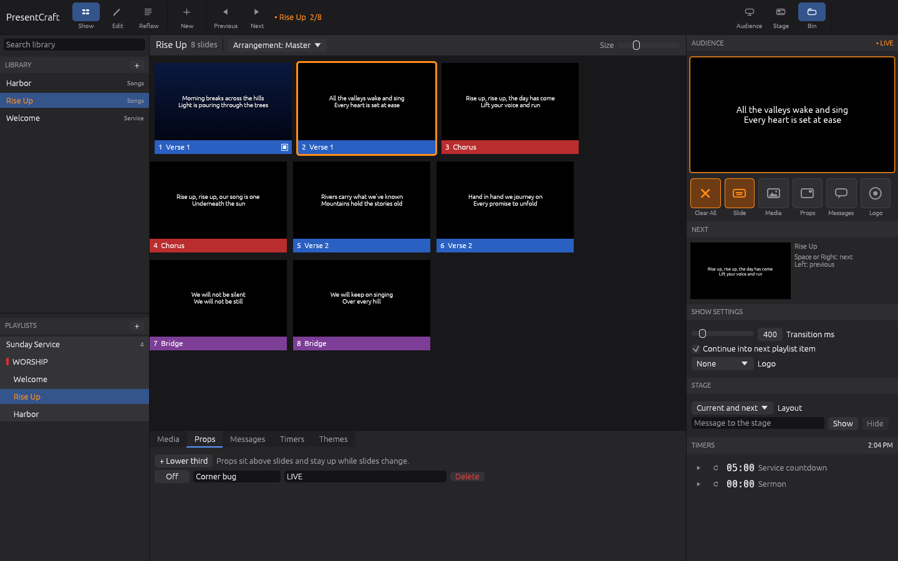
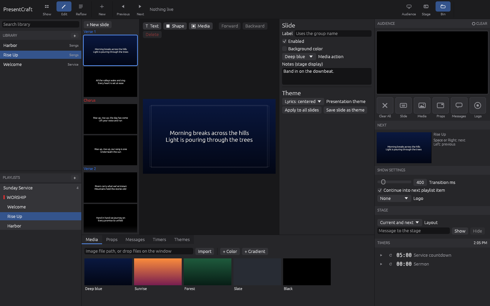
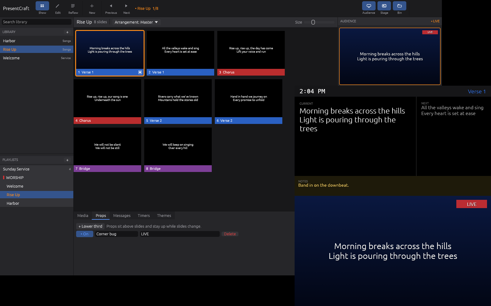
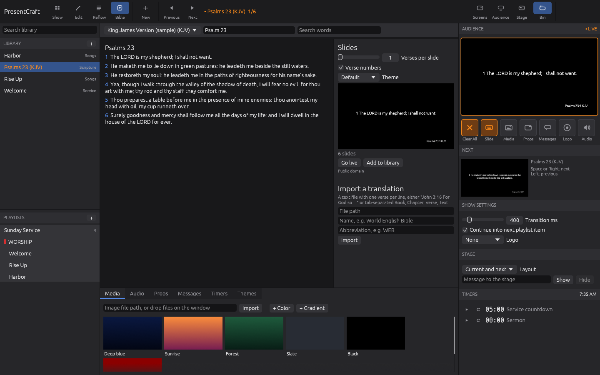

# PresentCraft

Live presentation software for worship services, events and broadcast, built in Rust with
[egui](https://github.com/emilk/egui) and the shared [craft-libs](https://github.com/storytold/craft-libs)
crates (`craft-ui`, `craft-settings`, `craft-atomic`).

The operator works in one window: library and playlists on the left, the slide grid in the
middle, the live audience preview and layer controls on the right, and a bin of media, props,
messages, timers and themes along the bottom. The audience output and the stage display each
open in their own window, ready to drag onto a projector or confidence monitor.



## Running

```sh
cargo run --release
```

On Linux the usual X11/Wayland desktop libraries are needed (`libxkbcommon-x11`, a GL driver), and
ALSA headers to build audio support (`libasound2-dev` on Debian and Ubuntu).

| Variable | Effect |
|---|---|
| `PRESENTCRAFT_DATA_DIR` | Folder for `library.json`. Set but empty keeps the library in memory only. |
| `PRESENTCRAFT_CONFIG_DIR` | Folder for preferences (`config.toml`). Set but empty keeps them in memory. |

## What it does

- **Show mode.** Click a slide to put it live. Slides are grouped (Verse, Chorus, Bridge…) with
  colored label bars. Space, Right, Down or Page Down go to the next slide; Left, Up or Page Up
  go back. At the end of a presentation, "next" continues into the next playlist item.
- **Layers.** Media (background), slide, props and messages are separate layers with their own
  clear buttons: Clear All (F1), Slide (F2), Media (F3), Props (F4), Messages (F5) and Logo (F6).
  Slides and backgrounds cross-fade with an adjustable transition.
- **Library and playlists.** Search titles and lyrics; drag a presentation onto a playlist; add
  headers; reorder, rename, duplicate and delete.
- **New presentations from lyrics.** Paste text: blank lines split slides, and `[Chorus]` or
  `Verse 2:` lines start groups.
- **Arrangements.** Reorder or repeat groups (V1 C V2 C B C) without duplicating slides.
- **Edit mode.** A 1920×1080 canvas with text boxes, shapes and media elements you can drag and
  resize (10 px snapping, hold Shift to move freely), plus an inspector for text, size, color,
  alignment, shadow, outline, caps, fills, slide background, media action and stage notes.
- **Reflow mode.** Edit the whole presentation as text; cues, notes and group colors carry over.
- **Themes.** Save a slide's look as a theme and apply it to a presentation.
- **Media bin.** Images (PNG, JPEG, BMP, WebP) and looping animated GIFs by path or drag-and-drop,
  plus generated colors and gradients; fill, fit or stretch scaling. A slide can fire media when it
  goes live.
- **Audio.** MP3, WAV, FLAC and Ogg Vorbis on their own layer with play/pause, seek, volume and
  Clear Audio (F7); a slide can start a track as its audio cue, and Clear All silences it.
- **Bible.** Type a reference ("John 3:16-18", "Ps 23", "1 Cor 13:4-8") or search words, choose
  verses per slide, verse numbers and a theme, then go live or add the passage to the library.
  Translations are imported from text files (one verse per line); a public-domain KJV sample is
  built in.
- **Props.** Lower thirds and corner bugs that stay up while slides change.
- **Messages.** Templates with `{tokens}` filled in at show time, and `{timer}` for live countdowns.
- **Timers.** Countdown, count down to a time of day, and elapsed, with optional overrun.
- **Stage display.** Current and next slide, notes, clock, running timer and a flashing stage
  message, in three layouts.
- **Outputs.** Audience and stage windows (Ctrl+1 / Ctrl+2). The Screens window sets where each
  one opens, its size and full screen, with a preset for the display to the right; windows also
  remember where you drag them. Double-click an output for full screen, Esc to leave.
- **Safe saving.** The library autosaves a second after each change with crash-safe atomic writes,
  and a damaged library file is never overwritten.

| Edit mode | Stage display and audience output |
|---|---|
|  |  |



## Roadmap

Planned next rounds: video playback, a stage layout editor, keyboard shortcut editor, slide
transitions per slide, macros and looks, NDI and network remote control, and import of common
song formats.

## Development

```sh
cargo fmt --check
cargo clippy --all-targets -- -D warnings
cargo test
```

Like the rest of the Craft suite the app never panics on bad input: `main.rs` denies `unwrap`,
`expect`, `panic` and friends, and `unsafe` is forbidden.

PresentCraft is an independent project, not affiliated with any other presentation software
vendor. All icons are drawn in code and all bundled demo content is original.
